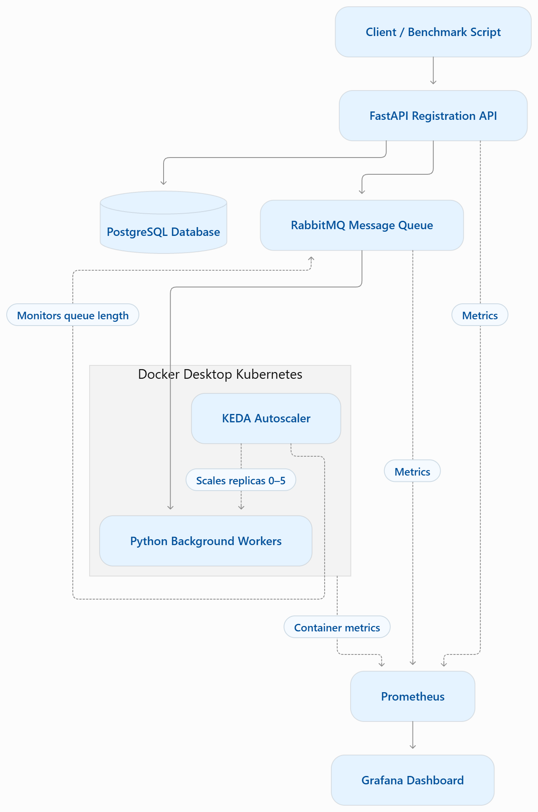
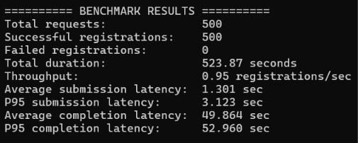
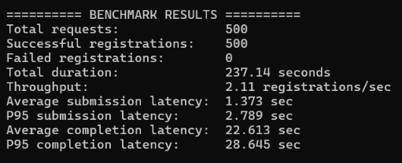

# QueueScale 

### An Intelligent Queue-Based Traffic Management and Auto-Scaling System for Cloud-Native Applications

<p align="center">

**Asynchronous Processing · RabbitMQ · Kubernetes · KEDA Autoscaling · Prometheus · Grafana**

</p>

---

##  Overview

QueueScale is a cloud-native application designed to handle sudden traffic spikes through asynchronous message processing and event-driven worker autoscaling.

Traditional applications with fixed processing capacity can experience server overload, increased request latency, and inefficient resource utilization when a large number of requests arrive simultaneously.

QueueScale addresses this challenge by introducing a message queue between request reception and background processing. It uses **RabbitMQ** to buffer incoming requests and **KEDA** to dynamically scale Kubernetes worker replicas according to queue length.

The system integrates FastAPI, PostgreSQL, Docker, Kubernetes, Prometheus, and Grafana to provide an efficient, scalable, and observable request-processing architecture.

###  Project Objectives

- Handle sudden increases in incoming requests without overloading application workers.
- Implement asynchronous request processing using RabbitMQ.
- Dynamically scale background workers based on queue length.
- Optimize resource utilization through Kubernetes scale-to-zero functionality.
- Maintain persistent registration records and processing status.
- Monitor application performance and infrastructure resources.
- Evaluate performance through fixed-worker and autoscaling benchmarks.

---

##  System Architecture

QueueScale follows a queue-based, event-driven architecture that separates incoming request handling from background processing.

### Architecture Diagram


**Architecture Components**

| Component | Responsibility |
|---|---|
| FastAPI | Receives registration requests and provides REST APIs |
| PostgreSQL | Stores registration details and processing status |
| RabbitMQ | Buffers incoming requests through asynchronous message queuing |
| Python Background Worker | Consumes and processes queued messages |
| Docker | Containerizes application services |
| Kubernetes | Manages application deployments and worker containers |
| KEDA | Automatically scales workers based on RabbitMQ queue length |
| Prometheus | Collects application and infrastructure metrics |
| Grafana | Visualizes system performance and resource utilization |

---

##  System Workflow

The QueueScale processing pipeline works as follows:

1. **Request Submission:** A client submits a registration request through the FastAPI endpoint.
2. **Request Validation:** FastAPI validates the incoming request.
3. **Database Storage:** Initial registration details are stored in PostgreSQL.
4. **Message Publishing:** A corresponding message is published to the RabbitMQ registration queue.
5. **Queue Monitoring:** KEDA monitors RabbitMQ queue length.
6. **Dynamic Scaling:** Kubernetes creates or removes worker replicas according to workload demand.
7. **Background Processing:** Python workers consume and process queued messages.
8. **Status Update:** PostgreSQL is updated with the final registration status.
9. **Scale Down:** When the queue becomes idle, KEDA scales down the worker deployment, potentially to zero.

### Asynchronous Processing

The API and background workers operate independently.

Instead of waiting for the complete registration-processing operation, the API publishes a message to RabbitMQ and returns a request identifier. The client can subsequently check the processing status using the status endpoint.

This architecture helps prevent long-running background operations from blocking request reception.

---

##  Technology Stack

| Category | Technologies |
|---|---|
| Programming Language | Python |
| Backend Framework | FastAPI |
| Database | PostgreSQL |
| Message Broker | RabbitMQ |
| Background Processing | Python Workers |
| Containerization | Docker, Docker Compose |
| Orchestration | Kubernetes |
| Event-Driven Autoscaling | KEDA |
| Metrics Collection | Prometheus |
| Monitoring Dashboard | Grafana |
| Benchmarking | Python, CSV, Matplotlib |
| Version Control | Git, GitHub |

---

##  Project Structure

```text
QueueScale/
│
├── app/
│   ├── __init__.py
│   ├── database.py
│   ├── main.py
│   ├── messaging.py
│   ├── models.py
│   └── worker.py
│
├── k8s/
│   ├── namespace.yaml
│   ├── api-deployment.yaml
│   ├── api-service.yaml
│   ├── worker-deployment.yaml
│   ├── scaled-object.yaml
│   ├── rabbitmq-trigger-auth.yaml
│   ├── rabbitmq-scrape.yaml
│   ├── queuescale-servicemonitor.yaml
│   ├── prometheus-patch.json
│   └── monitoring-values.yaml
│
├── references/
│
├── benchmark.py
├── generate_graphs.py
├── architecture.mmd
├── architecture.png
│
├── Dockerfile
├── docker-compose.yml
├── requirements.txt
├── .gitignore
├── README.md
│
├── fixed_workers_benchmark_50.csv
├── fixed_workers_benchmark_1000.csv
├── fixed_workers_benchmark_500_c50.csv
│
├── keda_benchmark_50.csv
├── keda_benchmark_100.csv
├── keda_benchmark_250.csv
├── keda_benchmark_1000.csv
├── keda_benchmark_500_c50.csv
├── keda_benchmark_500_c50_final.csv
├── keda_dashboard_test_50.csv
│
├── average_completion_latency.png
├── p95_completion_latency.png
└── average_submission_latency.png
```

---

## ⚙️ Prerequisites

Make sure the following tools are installed:

- Docker Desktop
- Docker Desktop Kubernetes
- kubectl
- Helm
- Python 3.8 or later
- Git
- KEDA
- Prometheus and Grafana

---

##  Installation and Execution

### 1. Clone the Repository

```bash
git clone https://github.com/nbhosale8222/QueueScale.git

cd QueueScale
```

### 2. Configure Environment Variables

Create a `.env` file containing the required PostgreSQL and RabbitMQ configuration.

Use the environment variable names expected by the application configuration.

**Important:** Never commit `.env` files, passwords, tokens, or other credentials to GitHub.

### 3. Start PostgreSQL and RabbitMQ

```bash
docker compose -p queuescale up -d postgres rabbitmq
```

Verify the containers:

```bash
docker compose ps
```

### 4. Build Application Images

```bash
docker build -t queuescale-api:latest .
```

```bash
docker build -t queuescale-worker:latest .
```

Ensure the images are available to your Kubernetes environment before deploying the workloads.

### 5. Deploy Kubernetes Resources

Apply the Kubernetes manifests in the appropriate dependency order.

For example:

```bash
kubectl apply -f k8s/namespace.yaml
```

Then configure the API service, worker deployment, RabbitMQ authentication, and KEDA ScaledObject using the corresponding manifests.

Ensure KEDA is installed and the RabbitMQ scaler can connect to the broker.

### 6. Access the API

Start the API port-forward:

```bash
kubectl port-forward service/queuescale-api 8001:8000 -n queuescale
```

API health endpoint:

```text
http://localhost:8001/health
```

### 7. Access Grafana

Start the Grafana port-forward:

```bash
kubectl port-forward -n monitoring svc/queuescale-monitoring-grafana 3000:80
```

Open:

```text
http://localhost:3000
```

### 8. Access Prometheus

```bash
kubectl port-forward -n monitoring svc/queuescale-monitoring-kube-prometheus 9090:9090
```

Open:

```text
http://localhost:9090
```

---

##  API Endpoints

| Method | Endpoint | Description |
|---|---|---|
| GET | `/` | Application root endpoint |
| GET | `/health` | Health check |
| POST | `/registrations` | Submit a new registration |
| GET | `/registrations/{request_id}` | Retrieve registration status |
| GET | `/metrics` | Expose application metrics |

### Example Registration Request

```json
{
  "student_name": "Demo Student",
  "event_name": "QueueScale Demo",
  "email": "demo@example.com"
}
```

The API returns a request identifier that can be used to track the registration's processing status.

---

##  KEDA Autoscaling Configuration

KEDA monitors RabbitMQ queue length and automatically adjusts the number of background worker replicas.

### Autoscaling Parameters

| Parameter | Configuration |
|---|---:|
| Minimum Replicas | 0 |
| Maximum Replicas | 5 |
| Queue Length Threshold | 5 messages |
| Scaling Trigger | RabbitMQ Queue Length |
| Target Deployment | queuescale-worker |

### Autoscaling Behaviour

**Scale Up:**
- Incoming requests increase the RabbitMQ queue length.
- KEDA detects the growing backlog.
- Kubernetes increases the number of worker replicas.
- Additional workers consume messages concurrently.

**Scale Down:**
- Workers process the pending messages.
- RabbitMQ queue length decreases.
- When the queue becomes idle, KEDA scales down the worker deployment.
- The deployment can return to zero replicas.

---

##  Monitoring and Observability

QueueScale integrates Prometheus and Grafana to provide real-time visibility into application performance and infrastructure behaviour.

### Grafana Dashboard

The monitoring dashboard contains eight panels:

| No. | Dashboard Panel | Description |
|---:|---|---|
| 1 | RabbitMQ Queue Depth | Number of messages waiting to be processed |
| 2 | RabbitMQ Unacknowledged Messages | Messages delivered to consumers but not yet acknowledged |
| 3 | RabbitMQ Active Consumers | Number of active queue consumers |
| 4 | API Request Rate | Incoming HTTP requests per second |
| 5 | API Average Response Latency | Average API response time |
| 6 | Kubernetes Worker Replicas | Number of running background worker replicas |
| 7 | Kubernetes Container CPU Usage | CPU consumption of application containers |
| 8 | Kubernetes Container Memory Usage | Memory consumption of application containers |

### Dashboard Screenshots

Add your dashboard screenshots to `docs/screenshots/` and use the following image references:

**1. Complete Grafana Monitoring Dashboard**


**2. RabbitMQ Queue Monitoring**


**3. Kubernetes Worker Autoscaling**


**4. CPU and Memory Monitoring**


---
##  Benchmark Execution Evidence

Both configurations were tested using 500 registration requests with a concurrency level of 50.

### 1. Fixed Worker Configuration

The system was configured with two fixed background workers.



### 2. KEDA Autoscaling Configuration

The system dynamically scaled background workers according to RabbitMQ queue length.



### 3. Performance Comparison

The following table summarizes the measured results from both configurations.

| Metric | Fixed Workers (2) | KEDA Autoscaling |
|---|---:|---:|
| Total Requests | 500 | 500 |
| Concurrency | 50 | 50 |
| Successful Registrations | 500 | 500 |
| Failed Registrations | 0 | 0 |
| Total Duration | 523.87 s | 237.14 s |
| Throughput | 0.95 req/s | 2.11 req/s |
| Average Completion Latency | 49.864 s | 22.613 s |
| P95 Completion Latency | 52.960 s | 28.645 s |

KEDA reduced total execution time by 54.73% and achieved approximately 2.22 times the throughput of the fixed-worker configuration.
##  Performance Evaluation

QueueScale was evaluated using two configurations:

**Configuration A — Fixed Workers**
- Two background worker replicas.
- Worker count remains constant during the benchmark.

**Configuration B — KEDA Autoscaling**
- Worker replicas are dynamically adjusted.
- Minimum replicas: 0.
- Maximum replicas: 5.

### Benchmark Methodology

A matched benchmark was conducted using:

| Parameter | Value |
|---|---:|
| Total Requests | 500 |
| Concurrency | 50 |
| Polling Interval | 0.5 seconds |
| Benchmark Timeout | 300 seconds |
| Fixed Worker Count | 2 |
| KEDA Worker Range | 0–5 |

Both configurations used the same application, database, message broker, and benchmark parameters.

### Final Benchmark Results

| Metric | Fixed Workers (2) | KEDA Autoscaling |
|---|---:|---:|
| Total Requests | 500 | 500 |
| Concurrency | 50 | 50 |
| Successful Registrations | 500 | 500 |
| Failed Registrations | 0 | 0 |
| Total Duration | 523.87 s | 237.14 s |
| Throughput | 0.95 req/s | 2.11 req/s |
| Average Submission Latency | 1.301 s | 1.373 s |
| P95 Submission Latency | 3.123 s | 2.789 s |
| Average Completion Latency | 49.864 s | 22.613 s |
| P95 Completion Latency | 52.960 s | 28.645 s |

### Performance Improvements

| Metric | Improvement with KEDA |
|---|---:|
| Total Benchmark Duration | 54.73% lower |
| Throughput | Approximately 2.22× higher |
| Average Completion Latency | 54.65% lower |
| P95 Completion Latency | 45.91% lower |
| P95 Submission Latency | 10.70% lower |

Both configurations achieved a **100% registration completion rate**, with zero failed requests.

The average submission latency was slightly higher in the KEDA test. However, KEDA demonstrated substantially better overall completion performance under the tested workload.

### Additional KEDA Benchmark Results

The following additional tests were conducted using different workload sizes and concurrency levels.

| Requests | Concurrency | Throughput | Average Completion Latency | P95 Completion Latency |
|---:|---:|---:|---:|---:|
| 50 | 10 | 0.61 req/s | 15.546 s | 24.438 s |
| 100 | 10 | 0.93 req/s | 20.547 s | 42.785 s |
| 250 | 10 | 0.90 req/s | 10.973 s | 14.786 s |
| 500 | 50 | 1.82 req/s | 26.449 s | 66.225 s |
| 1,000 | 10 | 0.96 req/s | 10.323 s | 10.603 s |
| 1,000 | 50 | 2.26 req/s | 21.614 s | 26.490 s |

*Note: The final matched 500-request comparison is reported separately above. Additional tests are not directly comparable when their concurrency settings differ.*


##  Key Features

- **Asynchronous Processing:** Separates request reception from background processing.
- **Message Queuing:** RabbitMQ buffers incoming requests during traffic spikes.
- **Event-Driven Autoscaling:** KEDA monitors queue length and adjusts worker replicas.
- **Scale-to-Zero:** Reduces idle worker allocation when there is no pending workload.
- **Persistent Storage:** PostgreSQL stores registration details and processing status.
- **Container Orchestration:** Kubernetes manages worker deployments.
- **Real-Time Monitoring:** Prometheus and Grafana provide infrastructure and application visibility.
- **Performance Benchmarking:** Compares fixed-worker and autoscaling configurations using measured latency and throughput.

---

##  Future Enhancements

- Implement bounded message retries.
- Introduce a Dead Letter Queue (DLQ) for failed messages.
- Add idempotent message processing.
- Improve failure recovery and fault tolerance.
- Conduct larger-scale workload testing.
- Evaluate CPU and memory efficiency under matched workloads.
- Extend monitoring with additional application-level metrics.
- Evaluate performance across different scaling thresholds and worker limits.

---

## 📌 Conclusion

QueueScale demonstrates how asynchronous message processing, message brokers, container orchestration, and event-driven autoscaling can be integrated to manage workloads in cloud-native applications.

The matched benchmark of 500 requests at concurrency 50 showed that KEDA autoscaling reduced total benchmark duration by 54.73% and improved throughput by approximately 2.22 times compared with two fixed workers.

The implementation also demonstrated dynamic worker scaling, scale-to-zero functionality, and monitoring through Prometheus and Grafana.

These results highlight the potential of queue-based autoscaling for handling bursty workloads while adapting processing capacity to workload demand.

---

##  Project Team

| Name | Registration Number |
|---|---|
| Nikhil Bhosale | RA2311031010035 |
| Abhishek Jaybhaye | RA2311031010075 |
| Ankit Kumar Sahu | RA2311031010100 |

---

##  Repository

**GitHub:** [QueueScale — GitHub Repository](https://github.com/nbhosale8222/QueueScale)

---

<p align="center">

**QueueScale — Intelligent Traffic Management Through Asynchronous Processing and Dynamic Autoscaling.**

</p>
